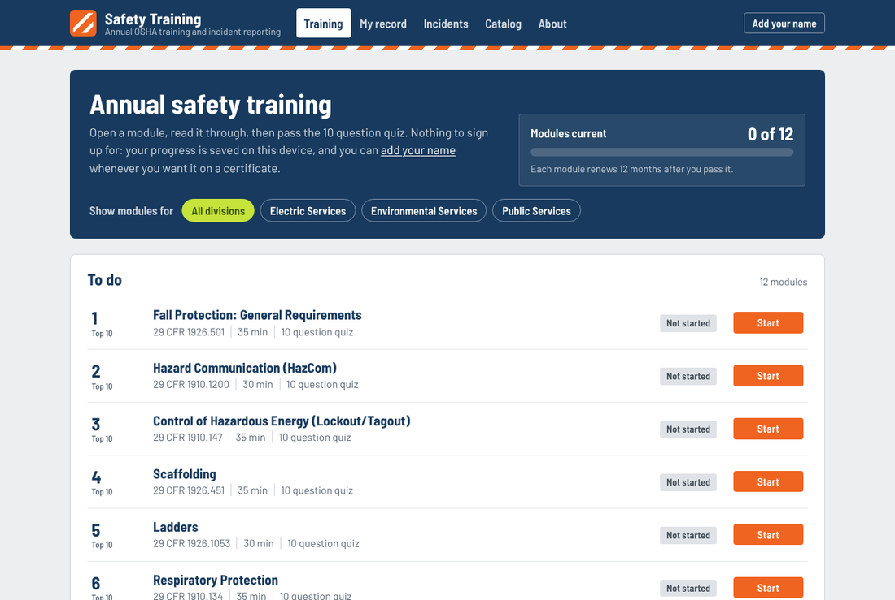
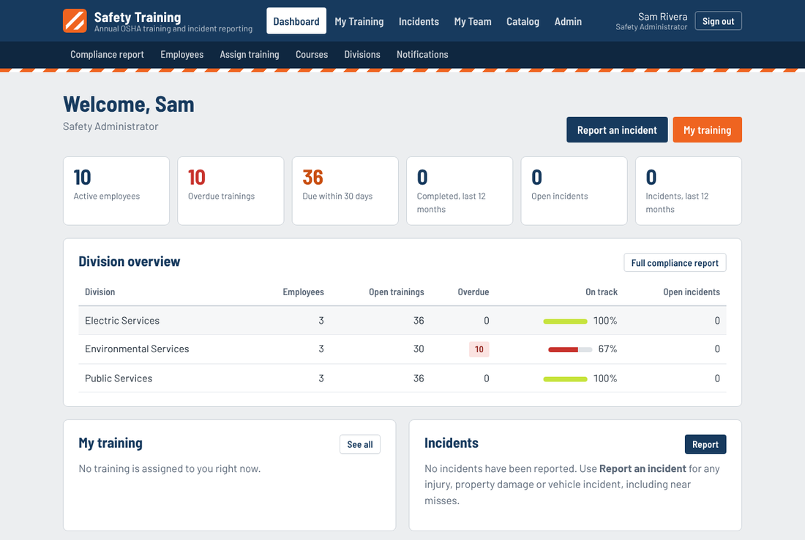

# IntelliSafe

The safety platform of **IntelliSafe Systems LLC**: annual OSHA training, incident reporting and investigation, and site inspections for departments with **Electric Services**, **Environmental Services** and **Public Services** crews.

**Licensed software by Tompkins Software Systems LLC.** See [LICENSE](LICENSE).

## Open it

There are two editions of the platform in this repository.

| | Browser edition | Full platform |
| --- | --- | --- |
| Where it runs | GitHub Pages, nothing to install, no sign-in | A small server (or a free GitHub Codespace for a trial) |
| Address | **https://tompkins52.github.io/Safety-Training/** | Your own address once it is hosted |
| 19 training modules and 10-question quizzes, new hire and supervisor tracks | Yes | Yes |
| Certificates and Excel export of the training record | Yes | Yes |
| Eight-section incident report with diagrams, statements, signatures, printable report | Yes (saved in the browser; export to JSON to hand in) | Yes (central records, statements signed through emailed links) |
| Site inspections (construction, general industry) and the annual program audit | Yes | Yes |
| Email reminders 30 days before due, 7 days, overdue, with copies to supervision | Calendar reminders (.ics download) | Yes, automatic |
| Supervisor completion and incident notices | "Email my record" and "Email this report" buttons | Yes, automatic |
| Employee accounts, assignments by division, individual assignments, compliance reports | No | Yes |

**Browser edition.** Open https://tompkins52.github.io/Safety-Training/ on any phone or computer. There is no account to create: the modules and quizzes open directly, and a name is only asked for when a certificate is printed. GitHub Pages serves it from the root of `main` (the files `index.html`, `app.js`, `data.js` and `styles.css` are generated; the source is in `site/`). The site is rebuilt automatically whenever course content changes on `main`. If Pages is ever switched off: Settings > Pages > Source "Deploy from a branch" > branch `main`, folder `/ (root)` > Save.

**Full platform, try it in five minutes.** Open the repository on GitHub, click **Code > Codespaces > Create codespace on main**, wait for the setup to finish, and the platform opens in a new browser tab with demo accounts loaded (see below). Codespaces is free for personal GitHub accounts within the monthly allowance.

**Full platform, hosted for the department.** Any of these works:
- [Deploy to Render](https://render.com/deploy?repo=https://github.com/Tompkins52/Safety-Training) using the included `render.yaml` (Starter plan with a persistent disk, about $8 per month; the file explains the free option).
- Docker on a city server: `docker compose up -d` (below).
- IT-managed Linux or Windows server: [docs/deployment.md](docs/deployment.md).





## What it does

**Annual training**

- Nineteen training modules: one for each of OSHA's Top 10 most frequently cited standards; **Pole Top Rescue** and **Bucket Truck (Aerial Lift) Rescue** for the Electric Services and Public Services divisions; **Bloodborne Pathogens**, **Fire Safety and Fire Extinguishers**, **Electrical Safety**, **Confined Spaces**, **Ergonomics and Safe Lifting** and **Workplace Violence and Active Shooter Response** for every division; and **Incident Reporting and Investigation** for supervisors and managers. Each module is written for public works crews, with division-specific examples.
- A **10-question quiz** at the end of every module. 80% passes (configurable), retakes are allowed, every attempt is recorded, and a printable certificate is issued on completion.
- Training is assigned by division. When an employee passes, next year's assignment is created automatically, due 12 months after completion, so the cycle is truly annual.
- A **required new hire track**: ten modules are flagged as new hire training and can be assigned in one step when an employee is added. The safety manager can also grant **individual assignments** to any employee, including modules outside their division.
- A course catalog that shows the current OSHA Top 10 list (preliminary FY 2026 and final FY 2025 are included) and which module covers each standard. The list lives in one data file and is updated once a year.
- The training record exports to **Excel** (per employee, per team, or the whole department) as well as CSV.

**Email notifications**

- Employees are emailed **30 days before** training is due, again at **7 days**, and every 7 days once it is overdue. **Their supervision receives a copy** at each of those points.
- **Direct supervisors are emailed** each time one of their employees completes a module, with the score and date.
- Safety administrators and the reporter's supervisor are emailed when an incident is reported, and the reporter and supervisor are emailed when it is closed. People asked for a statement receive a link to their own statement page.
- A daily scheduler runs inside the app, or the same job can be run from cron. Every message is kept in a notification log; when no mail server is configured the messages are logged instead of sent, so the platform works out of the box.

**Incident reporting and investigation**

The incident report follows the department's eight-section form. Report numbers are the incident date, the type code and the sequence for that day: `10232026PI-01` is the first personal injury on October 23, 2026 (`PD` property damage, `VI` vehicle incident).

1. **Incident information**, completed by the person conducting the investigation.
2. **Vehicle and equipment**: was a vehicle involved; type, make and model, license plate and city vehicle number; a **vehicle diagram** to circle the damage; a **scene sketch pad** with an intersection to draw over; machine, equipment or trailer involvement with a description or sketch.
3. **Personal injury**: mark the injured areas on a **body diagram**; injury type (burn, strain/sprain, laceration, amputation, contusion, fracture, other); body parts (head, eye, ear, face, neck, chest, shoulder, back, abdomen, groin, buttocks, upper arm, forearm, wrist, hand/finger, thigh/leg, knee, calf, ankle, foot/toe, other); treatment and OSHA recordability.
4. **Incident description.**
5. **Principal statements** and 6. **Eyewitness statements**: any number of each. Statements are **signed and dated digitally** by the person giving them, on the investigator's device or through an emailed link, without seeing the rest of the report; a statement received on paper can be attached with a blank form printed from the report.
7. **Safety representative's incident facts and analysis**: analysis of the facts, contributing causes, direct causes, root cause, contributing factor type (behavioral, engineered or environmental), recommended corrective actions with the responsible party, target date and verification date, and supporting references (policies, procedures, regulations). An incident cannot be closed until the causes and factor type are recorded.
8. **Signatures** of the investigator, manager, safety manager and department assistant director, drawn on screen.

The whole report prints to paper or PDF with the diagrams, sketches, statements and signatures. Access control: employees see the incidents they reported, supervisors see their division and their team, safety administrators see everything.

**Inspections and audits**

- **Site inspection checklists** for construction work (136 items, trenching, fall protection, electrical, cranes, traffic control and more) and general industry facilities and shops (137 items), each item tied to its OSHA reference, with a result, a note, and a corrective action, responsible party and target date for anything that needs attention.
- An **annual safety program audit** (69 items) covering the written programs, training records, recordkeeping, PPE, emergency planning, hazard communication, electrical safety, confined spaces and management involvement.
- Inspections are numbered, signed, printable and exportable to Excel.

**Administration and reporting**

- Employee accounts with division, direct supervisor and role (employee, supervisor, safety administrator). Temporary passwords are generated and must be changed at first login.
- A compliance matrix of every employee and every course, an overdue list, per-division statistics on the dashboard, and CSV and Excel exports.
- Bulk assignment by division and course, the new hire track, individual assignments, and course settings (which divisions each module applies to, renewal interval, active or inactive).

## Quick start

Requires Python 3.10 or newer.

```bash
git clone https://github.com/Tompkins52/Safety-Training.git
cd Safety-Training
python -m venv .venv
source .venv/bin/activate          # Windows: .venv\Scripts\activate
pip install -r requirements.txt
cp .env.example .env               # edit at least SECRET_KEY and ORG_NAME
export FLASK_APP=run.py            # Windows: set FLASK_APP=run.py

flask init-db                      # creates the database and loads the 19 modules
flask seed-demo                    # optional: demo divisions, employees and assignments
python run.py                      # http://localhost:5000
```

Demo accounts (all with password `Welcome123!`):

| Role | Email |
| --- | --- |
| Safety administrator | safety.admin@example.gov |
| Supervisors | electric.super@example.gov, environmental.super@example.gov, public.super@example.gov |
| Employees | j.carter@example.gov (Electric), r.patel@example.gov (Environmental), d.kowalski@example.gov (Public), and others |

For a real deployment skip `seed-demo` and create the first administrator with `flask create-admin`, then add employees under **Admin > Employees**. See [docs/deployment.md](docs/deployment.md) and [docs/admin-guide.md](docs/admin-guide.md).

### Docker

```bash
cp .env.example .env   # edit it
docker compose up -d --build
```

The app listens on port 8000. The SQLite database is kept in `./instance` and the course content in `./content`, both mounted from the host.

## Training modules

| # | Module | Standard | Divisions |
| --- | --- | --- | --- |
| 1 | Fall Protection: General Requirements | 29 CFR 1926.501 | All |
| 2 | Hazard Communication (HazCom) | 29 CFR 1910.1200 | All |
| 3 | Control of Hazardous Energy (Lockout/Tagout) | 29 CFR 1910.147 | All |
| 4 | Scaffolding | 29 CFR 1926.451 | All |
| 5 | Ladders | 29 CFR 1926.1053 | All |
| 6 | Respiratory Protection | 29 CFR 1910.134 | All |
| 7 | Powered Industrial Trucks (Forklifts) | 29 CFR 1910.178 | All |
| 8 | Fall Protection: Training Requirements | 29 CFR 1926.503 | All |
| 9 | Eye and Face Protection | 29 CFR 1926.102 | All |
| 10 | Machine Guarding | 29 CFR 1910.212 | All |
| | Pole Top Rescue | 29 CFR 1910.269 | Electric Services, Public Services |
| | Bucket Truck (Aerial Lift) Rescue | 29 CFR 1910.269, 1910.67 | Electric Services, Public Services |
| | Bloodborne Pathogens | 29 CFR 1910.1030 | All |
| | Fire Safety and Fire Extinguishers | 29 CFR 1910.157 | All |
| | Electrical Safety | 29 CFR 1910 Subpart S | All |
| | Confined Spaces | 29 CFR 1910.146 | All |
| | Ergonomics and Safe Lifting | OSH Act Section 5(a)(1) | All |
| | Workplace Violence and Active Shooter Response | OSH Act Section 5(a)(1) | All |
| | Incident Reporting and Investigation | 29 CFR 1904 | Supervisors and managers, all divisions |

New hire training (assigned when an employee is added): Hazard Communication, Fall Protection: General Requirements, Lockout/Tagout, Ladders, Eye and Face Protection, Bloodborne Pathogens, Fire Safety and Fire Extinguishers, Electrical Safety, Ergonomics and Safe Lifting, and Workplace Violence. The flag is the `new_hire` field in each module file.

Ranks 1 to 10 follow OSHA's preliminary FY 2026 list (October 1, 2025 to August 31, 2026). Division mapping can be changed by an administrator under **Admin > Courses**. Module content is written for public works and utility crews and refers to them by name; the platform itself is not tied to any one department.

Each module is a JSON file in `content/courses/` with learning objectives, six to eight content sections, key takeaways and its ten quiz questions with explanations. Edit the files and reload them from **Admin > Courses** or with `flask load-content`. See [docs/content-authoring.md](docs/content-authoring.md).

The training content is an awareness-level annual refresher. It summarizes the standards and does not replace the text of the regulations, the department's written programs, or the hands-on drills those programs require (for example timed pole top and bucket truck rescue drills).

## Project layout

```
site/            browser edition source (index.html, extra.css, js/ modules bundled into app.js)
scripts/         build_site.py writes the browser edition (to the repo root for GitHub Pages, or to dist/)
index.html, app.js, data.js, styles.css   generated browser edition served by GitHub Pages; do not edit by hand
app/
  blueprints/      auth, dashboard and team pages, training and quizzes, incidents, inspections, admin
  services/        assignments and grading, notifications, mailer, content loader, Excel exports, schema upgrades
  templates/       Jinja pages, printable report and certificate, statement pages, email templates
  static/          stylesheets, form widgets (diagrams, sketch and signature pads)
  models.py        SQLAlchemy models
  scheduler.py     daily reminder job (APScheduler)
  cli.py           flask commands
content/
  courses/*.json   the 19 training modules and quizzes
  inspections/*.json  inspection checklists and the annual audit
  osha_top10.json  OSHA Top 10 lists by fiscal year
docs/              deployment, administration, content authoring, updating the Top 10
tests/             end-to-end tests (pytest)
```

## Commands

| Command | Purpose |
| --- | --- |
| `flask init-db` | Create tables, default divisions and load course content (safe to re-run) |
| `flask load-content` | Reload modules and quizzes from `content/courses/` |
| `flask create-admin` | Create a safety administrator account |
| `flask seed-demo` | Load demo divisions, people and assignments |
| `flask assign-annual --due 2027-01-31` | Assign every applicable course to every active employee |
| `flask run-notifications` | Run the daily reminder job once (for cron) |
| `flask send-test-email you@example.gov` | Check the SMTP settings |
| `python scripts/build_site.py` | Build the browser edition into `dist/` |
| `python -m pytest tests` | Run the test suite |

## License

Copyright 2026 Tompkins Software Systems LLC. All rights reserved. This is licensed software; see [LICENSE](LICENSE) for the terms. The bundled Barlow and Libre Baskerville fonts are under the SIL Open Font License (see `app/static/fonts/`).
